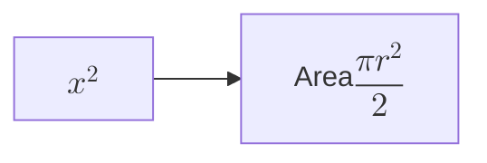

<script setup>
import PostHeader from 'components/PostHeader.vue';
</script>

<PostHeader />

[Mermaid Pele Preview](https://github.com/pdanpdan/mermaid-pele-preview) renders Mermaid diagrams in VS Code with [Pele](https://github.com/obsidianmd/pele). It opens `.mmd` and `.mermaid` files in a preview editor by default and renders fenced `mermaid` blocks in the built-in Markdown preview.

I picked Pele over Mermaid.js because it renders synchronously. Pele targets Mermaid 12.1.0 syntax with its own layout and gives you SVG without an async init step or a web worker. The editor just sends text and gets SVG back, then measures it. Pele isn't Mermaid.js, though. Syntax coverage and layout differ in places.

## Two surfaces, one renderer

Both end up in the same `DiagramView` class in the webview, but they get the source from different places.

For the custom editor, the extension host owns the document. `resolveCustomTextEditor` builds a webview with a strict CSP and a nonce, then sends the text when the webview says it's ready. Document changes are filtered by URI and debounced by 80 ms. The webview sends back `ready` and `saveSvg`; the host opens the save dialog and writes the file.

The Markdown preview is harder. VS Code sanitizes the HTML from a markdown-it plugin, so emitting an `<svg>` from the plugin doesn't work. The plugin replaces a `mermaid` fence with a placeholder:

```html
<pre
  class="pele-mermaid pele-theme-dark"
  data-font="..."
  data-icons="..."
  data-theme-vars="..."
  data-line="42"
>escaped diagram source</pre>
```

There's no SVG in that markup, just the source and theme data resolved in the extension host. `media/webview.js` is registered in `markdown.previewScripts`. It finds `pre.pele-mermaid:not([data-pele-mounted])`, builds a `DiagramView`, and replaces the `<pre>` with the figure. A `MutationObserver` on the document repeats the scan when the preview re-renders.

This is also why settings behave differently on the two surfaces. The custom editor updates live. The Markdown preview bakes theme, font, and icons into the placeholder when it renders, so you need a preview refresh or reopen after changing them.

## Rendering and measuring

Pele's own zoom and responsive behavior are turned off:

```js
mount(container, source, {
  zoom: false,
  responsive: false,
  maxWidth: Number.MAX_SAFE_INTEGER,
  icons,
  math,
});
```

I want the natural size so fit and zoom can be implemented in the extension. Natural size comes from the root SVG's `width` and `height`, then `viewBox`, then `getBoundingClientRect()` if those are missing. Empty input destroys the mounted view and shows a message. A render error becomes a short "Could not render diagram" hint instead of a broken figure.

The render is synchronous. That keeps state simple, but a large diagram blocks the webview thread. There's no lazy per-diagram loading; `media/webview.js` is one bundle of about 917 KB minified with Pele and Temml in it.

## Fit, zoom, pan

Fit is one line:

```js
fitScale = Math.min(1, container.clientWidth / naturalWidth);
```

Narrow diagrams stay at natural size. Wide ones shrink to the available width. A `ResizeObserver` on the viewport refits when the window changes, until you zoom manually. After that it keeps the current scale, unless the scale falls below the new fit.

Zoom buttons move in whole 100% steps: 100%, 200%, 300%, 400%. From a fitted size below 100%, the first step goes to 100%. `Ctrl`/`Cmd` + wheel is continuous and anchored at the pointer, so the content under the cursor stays put. Panning only turns on when the scaled width is larger than the container; it changes the SVG's `margin-left`, clamped to the scaled width. The container height grows with the zoom, so vertical overflow becomes page scroll instead of clipped content.

The toolbar lives in the webview: zoom percentage, minus, plus, reset, light/dark, save. It's positioned top-right, hidden until hover or focus, and hidden in print. Keyboard users get arrows to pan, `+`/`-` to zoom, and `0` to fit.

## Themes

`media/preview.css` maps Pele variables to VS Code tokens:

```css
--pele-bg: var(--vscode-editor-background);
--pele-series-1: var(--vscode-charts-blue);
/* ... */
--pele-font: var(--mermaid-view-font, var(--vscode-font-family));
```

`mermaidView.theme` is `auto`, `light`, or `dark`. In `auto` the webview reads `vscode-light` / `vscode-dark` from `body`. The per-diagram sun/moon button forces `pele-theme-light` or `pele-theme-dark` on that figure and wins over the setting. Click the active button again to go back to automatic.

A theme file is JSON with `light` and/or `dark` palettes. It's validated before use: 256 KiB max, 500 variables max, names matching `^--pele-[a-z0-9-]+$`, values length-limited and no `;{}<>` or control characters. If only one mode is defined, the other keeps the built-in palette. Omitted variables in a defined mode also fall back to the built-in palette for that mode, so a partial theme doesn't mix palettes.

SVG export isn't a serialization of the live DOM. The clone drops sizing styles so the file is at natural size, then walks the source and clone together and bakes computed `fill`, `stroke`, `stroke-width`, and `rx` into SVG nodes, plus `color` into HTML nodes. All `--pele-*` values are inlined on the clone root, and a background `<rect>` is added. The exported file no longer reacts to CSS variables. That's intentional: standalone viewers show the same colors.

## Math

Math labels use `$$...$$`:



Temml turns the TeX into MathML. Pele asks for a width and height, so the extension renders into a hidden probe, measures the `<math>` element, and returns the MathML with the measured size. Pele puts it in a `<foreignObject>`. Malformed expressions and zero measurements return `null`, and Pele falls back to the TeX source.

MathML inside `foreignObject` works in browsers, including in the exported SVG. Standalone SVG viewers may not render it. That's in the README; the only alternatives are rasterizing or converting math to paths.

## Icons

The extension doesn't bundle icon artwork. `mermaidView.iconPack` points at a JSON or gzipped JSON pack. The host scans the diagram source for icon references, resolves only those entries, and sends that subset to the webview on each update. Packs support path-based icons and a sanitized `<body>` for sets with circles, rectangles, or strokes. Scripts, styles, links, and event attributes are dropped by an allowlist.

Aliases map names from another icon set onto the names Pele passes. The Font Awesome pack is generated from the three Font Awesome packages, gzipped at level 9, and downloaded by a command. It isn't in the VSIX.

## Limitations

- VS Code sanitizes the Markdown preview, so the two-phase render isn't optional. There's no way to hand the preview an SVG from a markdown-it plugin.
- CSP is `default-src 'none'` with a nonce for the script. `style-src` allows inline styles because Pele theme variables and zoom/pan need them. Icons and fonts aren't fetched at render time; they come from the message or the bundle.
- The custom editor is live; the Markdown preview needs `markdown.preview.refresh` after a settings change.
- Export freezes colors and strips interaction. Zoom and pan don't survive because the export is at natural size.
- The extension vendors a TextMate grammar for `.mmd` / `.mermaid` and injects it into Markdown. Highlighting depends on the editor supporting that injection.

Install it from the [Marketplace](https://marketplace.visualstudio.com/items?itemName=pdanpdan.mermaid-pele-preview), or:

```sh
code --install-extension pdanpdan.mermaid-pele-preview
```

- [Code](https://github.com/pdanpdan/mermaid-pele-preview)
- [Documentation](https://github.com/pdanpdan/mermaid-pele-preview#readme)
